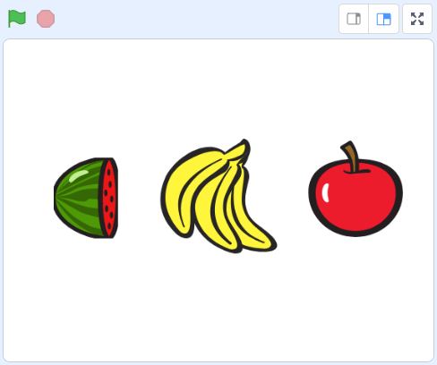

# Om oppgåva {.activity}

Dette er eit enkelt spel der tre figurar byter drakter. Spelaren må stoppe dei
når alle viser det same biletet (på same måte som ein einarma banditt-maskin).

## Oppgåva passar til: {.check}

__Fag__: Matematikk, programmering.

__Anbefalte trinn__: 3.-10. trinn.

__Tema__: Løkker, spel.

__Tidsbruk__: Dobbelttime eller meir.

## Kompetansemål {.challenge}

- [ ] __Matematikk, 5. trinn__: utforske og beskrive tilfeldigheit og sannsyn i
  spel og praktiske situasjonar, og knyte det til brøk

- [ ] __Programmering, 8.-10. trinn__: bruke grunnleggende prinsipper i
  programmering, slik som variabler, løkker, vilkår og funksjoner, og reflektere
  over bruken av disse

- [ ] __Programmering, 8.-10. trinn__: planlegge og skape et digitalt produkt og
  vurdere dette med tanke på brukervennlighet

## Forslag til læringsmål {.challenge}

- [ ] Elevane kan bruke løkker til å få noko til å skje, og ein variabel til å
  stoppe gjentakinga på ønskt tidspunkt.

- [ ] Elevane kan gjenskape eit kjent produkt frå samfunnslivet med eiga kode.

- [ ] Elevane kan lage eit program som tek input frå brukaren på passande måte.

- [ ] Elevane kan lage ein funksjon som byter utsjånad på ein figur etter ønskt
  mønster.

- [ ] Elevane kan samtale om sjansespel og sannsyn, og vurdere vinnarsjansen ut
  frå ulike føresetnader i spelet.

## Forslag til vurderingskriterium {.challenge}

- [ ] Eleven syner middels måloppnåing ved å fullføre oppgåva.

- [ ] Eleven syner høg måloppnåing ved å vidareutvikle eigen kode basert på
  oppgåva, til dømes ved å gjere ein eller fleire av variasjonane under.

## Føresetnader og utstyr {.challenge}

- [ ] __Føresetnader__: Elevane bør vere komfortable med Scratch.

- [ ] __Utstyr__: Datamaskiner med Scratch installert. Eventuelt kan elevane
  bruke Scratch i nettlesaren viss dei har ein brukar (eller registrerer seg) på
  [scratch.mit.edu/](https://scratch.mit.edu/). Elevane kan gjerne jobbe to og
  to saman.

## Framgangsmåte

Her finn du tips, erfaringar og utfordringar til dei ulike stega i oppgåva.
[Klikk her for å sjå oppgåveteksten.](../enarmet banditt/enarmet
banditt_nn.html){target=_blank}

_Me har diverre ikkje nokre tips, erfaringar eller utfordringar knytta til denne
oppgåva endå._

## Variasjonar {.challenge}

- [ ] Elevane kan lage ein teljar som viser poengsummen til spelaren. Den kan gi
  plusspoeng kvar gong spelaren får tre like drakter, og minuspoeng for tap
  eller som innsats.

- [ ] Elevane kan leggje til lydklipp som passar til ei slik spelemaskin.

## Eksterne ressursar {.challenge}

- [ ] Førebels ingen eksterne ressursar...
