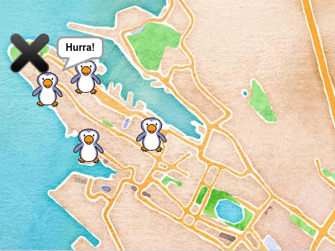

# Om oppgaven {.activity}

I denne oppgaven skal elevene lage et enkelt spill hvor spilleren skal få
pingviner som beveger seg tilfeldig rundt omkring til å gå tilbake til akvariet
i Bergen.

## Oppgaven passer til: {.check}

 __Fag__: Matematikk, programmering.

__Anbefalte trinn__: 3.-10. trinn.

__Tema__: Spill, musikk.

__Tidsbruk__: Dobbelttime.

## Kompetansemål {.challenge}

- [ ] __Matematikk, 2. trinn__: lage og følge regler og trinnvise instruksjoner
  i lek og spill

- [ ] __Programmering, 8.-10. trinn__: bruke grunnleggende prinsipper i
  programmering, slik som variabler, løkker, vilkår og funksjoner, og reflektere
  over bruken av disse

## Forslag til læringsmål {.challenge}

- [ ]  Elevene kan bruke kode for å få en figur til å rotere.

- [ ]  Elevene kan bruke løkker for å få noe til å skje flere ganger.

## Forslag til vurderingskriterier {.challenge}

Det er mange ulike måter en kan vurdere et programmeringsprosjekt, og her må en
selv vurdere hva som er den beste måten ut ifra hvilket fag man jobber i,
hvilken aldergruppe og hvilket nivå elevene er på, hva man ønsker å teste og
hvor mye tid man har til rådighet til å jobbe med prosjektet. I vårt
lærerdokument har vi blant annet beskrevet ulike måter dette kan gjøres på,
tillegg til en del andre nyttige tips til hvordan man underviser i
programmering.

## Forutsetninger og utstyr {.challenge}

- [ ]  __Forutsetninger__: Ingen, fin introduksjon til Scratch.

- [ ] __Utstyr__: Datamaskiner med Scratch installert. Eventuelt kan elevene
      bruke Scratch i nettleseren dersom de har en bruker (eller registrerer
      seg) på [scratch.mit.edu/](http://scratch.mit.edu/){target=_blank}.
      Elevene kan gjerne jobbe to og to sammen.

## Fremgangsmåte

[Klikk her for å se
oppgaveteksten.](../pingviner_pa_tur/pingviner_pa_tur.html){target=_blank}

_Vi har dessverre ikke noen tips, erfaringer eller utfordringer tilknyttet denne
oppgaven enda._

## Variasjoner {.challenge}

- [ ]  Elevene kan lage flere pingviner som er synlige samtidig.

- [ ]  Elevene kan lage pingviner som beveger seg med ulike hastigheter.

- [ ]  Elevene kan finne andre tema for spillet - løver i Afrika, for eksempel.

- [ ]  Elevene kan lage en variabel som teller poeng for hver pingvin som kommer
       tilbake til akvariet.

## Eksterne ressurser {.challenge}

- [ ] Foreløpig ingen eksterne ressurser ...
