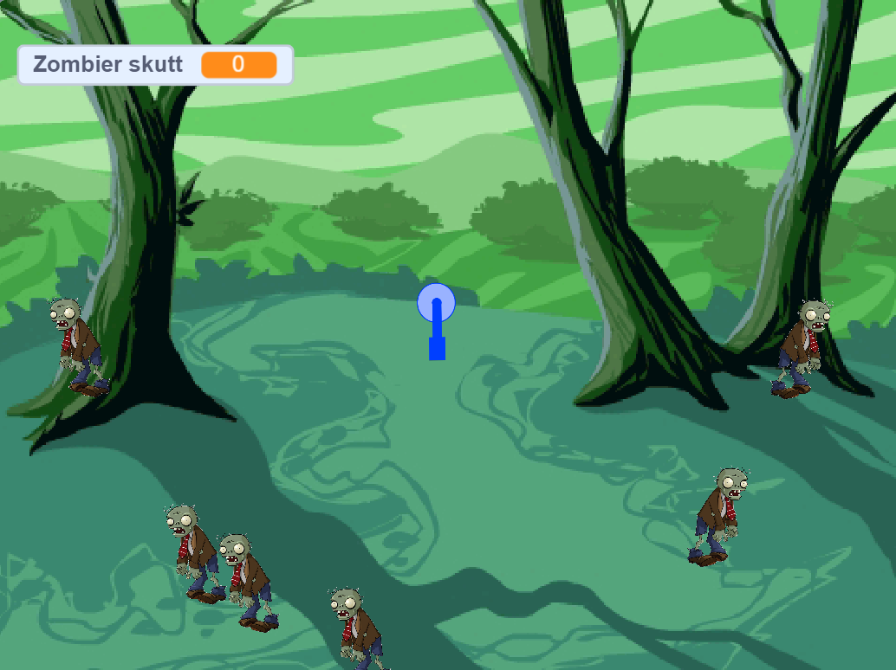

# Om oppgaven {.activity}

I denne oppgaven skal elevene remikse et halvveis fungerende spill og fullføre
koden selv.

## Oppgaven passer til: {.check}

 __Fag__: Matematikk, programmering

__Anbefalte trinn__: 3.-10. trinn

__Tema__: Koordinatsystem, kreativitet.

__Tidsbruk__: Dobbelttime eller mer.

## Kompetansemål {.challenge}

- [ ] __Matematikk, 4. trinn__: lage algoritmer og uttrykke dem ved bruk av
  variabler, vilkår og løkker

- [ ] __Programmering, 8.-10. trinn__: analysere problemer, gjøre dem om til
  delproblemer og gjøre rede for hvordan noen av delproblemene kan løses med
  programmering

## Forslag til læringsmål {.challenge}

- [ ] Elevene kan bruke kode og brukerinteraksjon til å beskrive rotasjon i et
  koordinatsystem.

- [ ] Elevene kan plassere en figur i et rutenett, og beskrive flytting av denne

- [ ] Elevene kan bruke kode til å finne og skyte zombier.

## Forslag til vurderingskriterier {.challenge}

- [ ] Eleven viser middels måloppnåelse ved å kode en løsning som lar spilleren
  styre og skyte zombiene.

- [ ] Eleven viser høy måloppnåelse ved å kode en løsning som skyter zombiene
  automatisk.

## Forutsetninger og utstyr {.challenge}

- [ ] __Forutsetninger__: Elevene bør være komfortable med Scratch

- [ ] __Utstyr__: Datamaskiner med Scratch installert. Eventuelt kan elevene
      bruke Scratch i nettleseren dersom de har en bruker (eller registrerer
      seg) på [scratch.mit.edu/](http://scratch.mit.edu/){target=_blank}.

## Fremgangsmåte

[Klikk her for å se
oppgaveteksten.](../zombiekanon/zombiekanon.html){target=_blank}

_Vi har dessverre ikke noen tips, erfaringer eller utfordringer tilknyttet denne
oppgaven enda._

## Variasjoner {.challenge}

- [ ] Elevene kan legge til flere lydeffekter.

- [ ] Elevene kan lage flere monstre som dukker opp på skjermen.

- [ ] Elevene kan endre hastigheten for å gjøre spillet enklere eller
  vanskeligere.

## Eksterne ressurser {.challenge}

- [ ] Foreløpig ingen eksterne ressurser...
